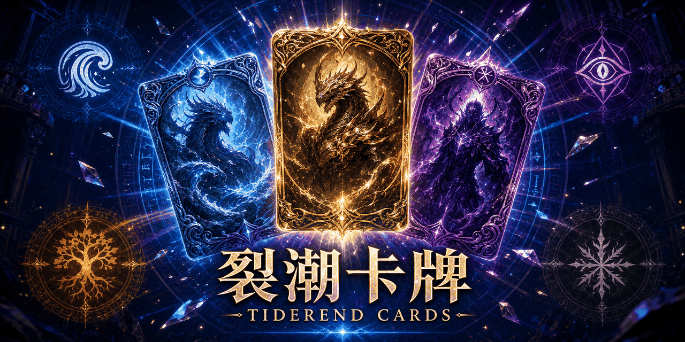
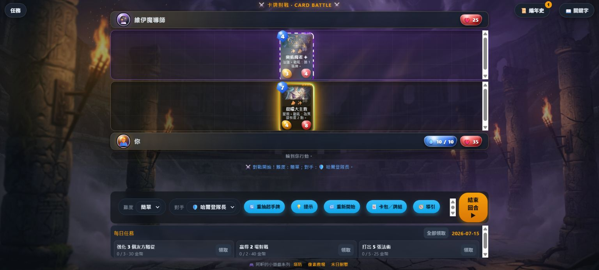
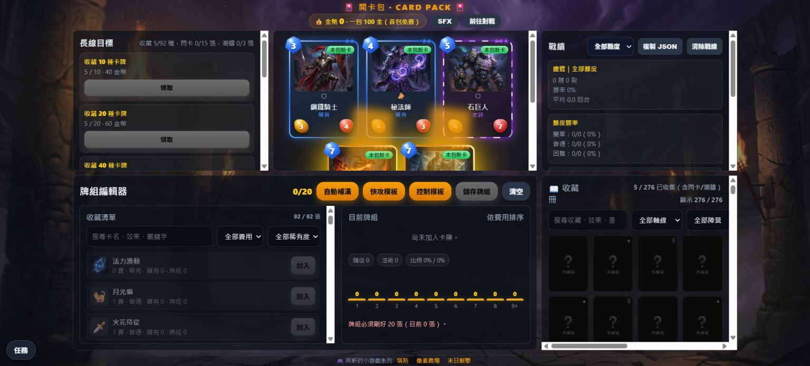
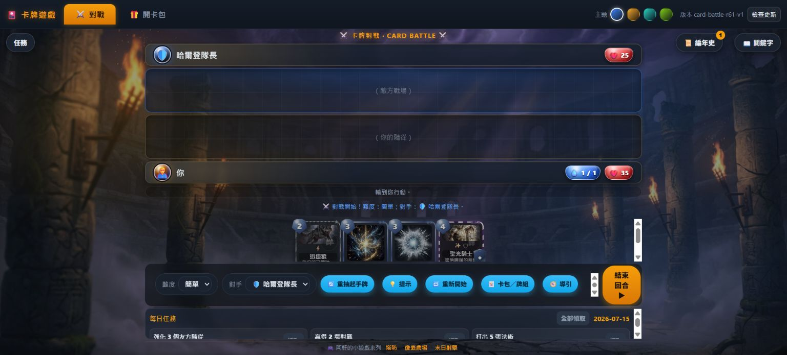

# 裂潮卡牌｜TIDEREND CARDS

[](https://github.com/mars-tw/web-card-game-skill/actions/workflows/ci.yml)
[](LICENSE)
[](https://mars-tw.github.io/web-card-game-skill/)



《裂潮卡牌》是一款以原生 HTML、CSS 與 JavaScript 製作的單人網頁卡牌對戰遊戲。玩家可以開卡包、收集卡牌、組成 20 張牌組，在自由對戰挑戰三位具名 AI，或沿五站航程對抗五位對手；任務、收藏、牌組與戰績皆保存在瀏覽器 `localStorage`，遊戲執行時不需要後端服務。

**[立即線上遊玩](https://mars-tw.github.io/web-card-game-skill/)**

目前版本：`0.20.0`／PWA revision `card-battle-content-r7-v1`。

新內容 R7 修正 R6 審查：殘局放大機制籤，第三題英雄改標「本題不計」，第四題註明開局受傷；交換時保留四卡血量預覽與完整確認／取消。潮向說明跟著實際反轉改變，預報與施放面板統稱「潮汐預報」，返回戰場仍看得到被反轉的回合。敵方茉恩、護盾到敵方騎士的關係與擋一次均有標籤，治療命中顯示 +3；藍菱形另標為嘲諷。沿用現有美術，沒有新增玩法或畫作。驗收與手機原圖見 `docs/CODEX_RESPONSE_CONTENT_R7.md`。

## 潮汐研習與預報航程（R7 修正）

港口、五站航程與研習選單都以「六道潮汐殘局」「潮汐預報」「茉恩的退潮考驗」為入口名稱。六題可直接選：陣亡蓄潮、剝盾、退潮保人、清嘲諷後斬殺、單體法術接潮傷、雙線交換。首題逐步引導，第二至六題只給目標與盤面情境。錯序會標出卡片與缺少的步驟，可立即重試。「六道已解」封頂 6/6，複驗獨立顯示 0/1；研習六題下方常駐「複驗：護住騎士」，鎖定時列出開啟條件，解完六題就能直接進入。

殘局選取友軍後，卡下會預覽交換後血量與退場者；確認才交戰，取消不改盤面。六題在正常遊玩時隱藏題名，以貝盾、嘲諷、射線、火焰箭和雙線盤面辨認機制。

港口「自由對戰／五站航程」的「潮汐預報」進入一般預報對戰；研習內保留固定短局。預報只問要反轉哪一回合，按住先看直接後果，放開套用、移出取消，一局一次。潮汐預報只突出可用方向；方向不符時顯示灰色「目前不可用」，不消耗資源。第四回合恢復自由潮術。

「茉恩的退潮考驗」先結束整備回合，觀察她舉手退潮、護住騎士，再依盾與血量安排反攻。茉恩沿用 R6 生成的三個姿勢呈現整備、蓄勢與命中，回復到整備姿勢；護航線指向敵方騎士，盾裂留在卡角，卡名與攻血保持可讀。這場仍採手工腳本，斷網時顯示離線狀態。R6 的 1 張原圖／3 張姿勢裁圖見 [R6 來源](docs/art/ASSET_MANIFEST_CONTENT_R6.json)，R7 沿用而未新增美術。隨從人物攻擊姿勢仍待補；目前呈現的是按命中時點結算的卡牌交戰回饋。

研習三項使用既有真卡與核心結算，不改收藏、不發金幣、不計勝敗；戰績頁有 0 勝場與研習已通過的說明。正式茉恩首領完成後，港口顯示通過狀態。進度、反轉次數、茉恩狀態與安全檢查點納入卡包頁「匯出存檔／匯入存檔」，錯誤碼會置中提示且保留原存檔。敵回合中離開回到上一個安全玩家回合。測試：`npm run test:content:r7`；原尺寸圖與五項驗收索引見 `docs/CODEX_RESPONSE_CONTENT_R7.md`，15 張手機精選位於 `docs/content/r7/review-set/`，三項各 5 張。

R75「月裂海藏」美術重做：生成夜港、甲板、歸航背景與領航員；試航卡圖、浪紋稀有度框、六格潮位尺及主要圖示已接入遊戲。來源、實際工具、透明底與壓縮紀錄見 [美術 manifest](docs/art/ASSET_MANIFEST.json)，前後圖見 [比較資料夾](docs/art/compare/)。這些是靜態插畫與 UI 效果，沒有新增人物逐幀動畫。

## 潮汐領航（R74）

根入口進入專屬港口。「潮汐試航」以兩次正式交換教陣亡蓄潮，再用滿六格的漲潮破解防線；短局不計戰績或發金幣。一般對戰可從「潮汐預報」選擇漲潮破陣或退潮護航（友軍聖盾、英雄最多回復 3 點），施放前顯示當前場面預覽。快捷裂潮鈕維持漲潮。

潮汐預報可儲存返回港口，再由「繼續上次對局」恢復安全的玩家回合檢查點；敵方行動中關閉會回到前一個檢查點。試航完成紀錄、對局、收藏均保存在本機。安全對局檢查點已隨第二輪存檔碼備份；舊試航完成旗標仍只保存在裝置上。

商店差異、隱私核對、英文審查備註及真實截圖見 [商店草稿](docs/store/DIFFERENTIATION.md)。人物姿勢及配樂仍缺；`pose-player.js` 提供可替換三段幀播放介面，沒有素材不會假稱動畫完成。上架風險及測試證據見 [R74 報告](docs/CODEX_RESPONSE_R74_STORE.md)。

## 手機與五站歸航（R73）

- 手機點手牌先預覽，再按「確認出牌」；也能上拖到己方戰場後預覽。橫滑看牌、放回原處或中斷觸控都不會出牌。桌機保留點選出牌。
- 從「⋯ → 航程／試用牌組」出發，依序挑戰白潮、荒野、殘響、霜牙、長暮；每站提供劇情、打法提示與下一站目標，勝利才推進。
- 20 張「荒野突襲」起始可試用，通過第 1／3 站解鎖「白潮列陣」／「殘響詠潮」。可切回自己的收藏牌組；試用不增加收藏，也不覆寫原牌組。
- 航程進度包含在完整存檔匯出／匯入；匯入未包含航程的舊版存檔，保留當前航程。

驗證與限制見 [R73 手機報告](docs/CODEX_RESPONSE_R73_MOBILE.md)。

## 招牌玩法：裂潮（R72）

- **潮能**：雙方各有 0–6 潮能，每回合開始 +1、己方隨從陣亡 +1——越被壓著打，浪頭越快回來。
- **裂潮爆發**：滿潮時按「裂潮」（0 費），對所有敵方隨從造成 1 點、敵方英雄 2 點，潮能歸零。現在放還是留著清場、斬殺，是每局都要做的時機判斷。
- **對手潮汐親和**：哈爾登「守城潮」、維伊「詠潮」（施法也充能）、斯卡拉「血潮」（陣亡充能加倍），三位對手的節奏各不相同；AI 會看局面決定何時掀浪。
- **星級挑戰**：每位對手 × 難度三顆星（獲勝／生命過半／用過裂潮爆發），結算逐顆點亮並記錄最佳成績。
- **開場與回饋**：VS 開場演出（對手立繪、台詞、戰場）、回合橫幅、潮浪橫掃特效。

## 最新特色（R60–R61）

- **「對座六影」具名傳說角色卡**：哈爾登隊長、維伊魔導師、斯卡拉狼首、伊索德·長暮、霜牙百夫長·魯恩、潮間仲裁者·茉恩；六張卡各有專屬機制與唯一構築限制。
- **角色專屬立繪**：R61 為六位角色補齊統一風格立繪，並接入戰場、開包揭示與收藏冊；卡面美術為 AI 產出，詳見 [CREDITS.md](CREDITS.md)。
- **角色抽取保護**：抽到傳說時有 28% 機率偏向角色子池；連續 35 包未取得角色傳說時觸發保底，並優先補未擁有角色。
- **具名 AI 對手**：哈爾登偏控制、維伊偏法術、斯卡拉偏快攻；可切換簡單、普通、困難與動態難度調節。
- **完整對戰表現**：傳說框掃光、閃卡虹彩、潮印收藏變體、英雄資源寶石、低血量警示，以及可停用的高動態效果。

## 遊戲內容

- **回合制對戰**：法力上限 10、場面上限 7、手牌上限 8，包含疲勞、目標選擇、AI 提示與戰鬥紀錄。
- **92 張卡牌**：25 普通、24 稀有、23 史詩、20 傳說；涵蓋白潮守軍、奧術結社、荒野獸群、凜冬暗影與潮間中立五個陣營。
- **多種規則能力**：嘲諷、衝鋒、戰吼、亡語、聖盾、連擊、劇毒、回復、吸血、突襲、靜默、法強及角色專屬機制。
- **卡包與收藏**：每包 5 張，首包免費、其後每包 100 金幣；稀有以上 20 包保底，另有 8% 閃卡與 3% 潮印變體。
- **牌組工作台**：20 張牌組、同名卡最多 2 張、傳說卡最多 1 張；提供搜尋、費用／稀有度／陣營／關鍵字篩選、曲線圖與快攻／控制模板。
- **長期進度**：每日任務、每週任務、收藏里程碑、白潮編年史、戰績統計與存檔匯出／匯入。
- **PWA 與響應式介面**：支援安裝、離線 fallback、桌機與手機版面、文字大小、音效開關、效能模式與 `prefers-reduced-motion`。

## 操作說明

### 對戰

1. 點選手牌打出隨從或法術；需要指定目標的效果會再提示可選對象。
2. 點選己方可攻擊的隨從，再點敵方隨從或英雄完成攻擊；場上有嘲諷時必須先處理嘲諷目標。
3. 使用「提示」查看本回合建議，操作完成後按「結束回合」。
4. 可隨時切換難度與對手；「重新開始」會依目前設定開新局。

### 開包、收藏與組牌

1. 進入「開卡包」，點卡包後逐張翻牌，或使用略過按鈕一次揭示。
2. 在收藏區搜尋及篩選卡牌；點卡牌可看詳情，分解操作需二次確認。
3. 在牌組編輯器加入或移除卡牌，也可套用快攻／控制模板；合法牌組必須正好 20 張。

介面支援滑鼠、觸控與鍵盤焦點操作；翻牌可用 `Enter`／`Space`，`Esc` 可關閉已開啟的詳情、編年史或任務面板。

## 遊戲畫面

### 具名 AI 對戰



### 開包與牌組工作台



### 桌機遊戲 Shell



## 技術棧

| 類別 | 使用技術 |
|---|---|
| 前端 | HTML5、CSS3、原生 JavaScript（CommonJS 測試相容） |
| 資料與離線 | `localStorage`、Web App Manifest、Service Worker |
| 測試 | Node.js 規則測試、品質守門、平衡模擬、Playwright E2E／RWD |
| CI/CD | GitHub Actions、GitHub Pages |
| 執行期依賴 | 無；瀏覽器直接載入靜態檔案 |

## 本地開發

需求：Node.js 20+、npm、Python 3（只用來啟動靜態伺服器）。

```bash
git clone https://github.com/mars-tw/web-card-game-skill.git
cd web-card-game-skill
npm install
npm start
```

開啟 <http://localhost:8000/templates/index.html>。伺服器必須從 repo 根目錄啟動，否則卡面圖片的相對路徑會失效。

### 測試

```bash
npm test
npx playwright install chromium   # 首次執行瀏覽器測試前
npm run test:e2e
npm run test:rwd
```

- `npm test`：卡牌資料、核心規則、品質守門與平衡模擬。
- `npm run test:e2e`：實際瀏覽器中的對戰、開包、牌組、存檔與 PWA 流程。
- `npm run test:rwd`：Shell、對戰與卡包頁面的多視口矩陣。

進一步的資料格式與美術流程請參考 [references/data-model.md](references/data-model.md) 與 [references/art-generation.md](references/art-generation.md)。貢獻方式見 [CONTRIBUTING.md](CONTRIBUTING.md)。

## 素材、授權與致謝

- 原始碼採 [MIT License](LICENSE)，© 2026 mars-tw。
- AI 卡面、背景、專案圖像、系統字型與第三方開發工具的盤點見 [CREDITS.md](CREDITS.md)。
